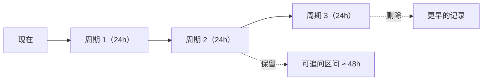

# 分析历史

每次分析成功后，Bot 会把**日志压缩包原文**与**追问上下文**归档到历史目录，并记录本次发出的全部消息 ID。

这样即使内存中的追问会话已过期，只要日志包还在保留期内，随时引用旧消息都能继续追问。

## 存储布局

```text
data/<配置名>/history/
  ├── records.json          # 全部记录的元数据（含消息 ID）
  ├── followups.json        # 追问会话状态（轮数 / 问答 / 消息 ID）
  ├── .staging/             # 分析进行中的解压暂存区（崩溃残留由清理周期扫掉）
  └── <记录ID>/
      ├── source.zip        # 日志压缩包原文
      ├── context.txt       # 追问上下文（日志摘要 + 代码参考）
      └── extracted/        # 解压后的日志内容（日志工具直接读这里）
          └── .maa-extracted.json   # 复用标记：压缩包 size+mtime 指纹与成员列表
```

`extracted/` 让**追问不必反复解压**：日志包工具（`log_search` / `log_read_file` …）
直接读解压后的真实文件，追问与重启后只要标记与压缩包一致就复用同一目录；
记录被清理时整目录一并删除，磁盘占用与追问窗口严格对齐。

`followups.json` 让**重启后仍能继续追问**：追问过的轮数、问答历史与
追问回复的消息 ID 都在这里，因此新进程能接着旧会话往下答。记录被清理时，
对应的会话状态会一并删除。

> **记录 ID** = `<纳秒时间戳>_<随机后缀>`。归档前会检查目录是否已存在，
> **绝不覆盖**已有记录（旧格式 `<秒>_<记录数+1>` 在同一秒、以及记录被清空后
> 都会复用，导致包被覆盖、追问串到别的记录）。
>
> **索引损坏保护**：`records.json` 解析失败时会先备份成
> `records.json.bad-<时间戳>` 再重建索引；若备份也失败，该配置进入写保护，
> 宁可暂不落盘也不覆盖唯一一份数据。

> `history_enabled = false` 时不写历史，解压落在系统临时目录（`maa_logs_*`）并在分析结束时删除。
> 注意：关闭这个开关**不会**清掉磁盘上已经存在的归档，既有历史仍按周期清理。

## 保留策略（按周期，非滑动窗口）

每过一个 `history_period_hours` 检查一次，删除创建时间超过
`history_period_hours × history_keep_periods` 的记录。



默认 `1d` 周期、保留 `2` 周期 ⇒ 记录可存活 **2~3 天**，因此这段时间内上传过的日志都能继续追问。

> 清理任务默认每 3600s 执行一次（正常模式与调试模式都会启动）。
> `keep_periods <= 0` 时全部视为过期（用于 `purge`）。

## 相关设置

| 设置项 | 默认 | 说明 |
| --- | --- | --- |
| `history_enabled` | `true` | 是否归档分析历史 |
| `history_period_hours` | `24` | 保留周期（小时） |
| `history_keep_periods` | `2` | 保留多少个周期，超出即删除 |
| `history_max_records` | `200` | 记录条数安全上限（防磁盘写满） |
| `history_max_total_mb` | `4096` | 历史目录总大小安全上限 MB（**按记录目录 + 索引文件实际占用现算**，含追问阶段补解压的 `extracted/` 与报告正文所在的 `records.json`） |

> 清理与 `/maa history` 统计都按**实际磁盘体积**现算：分析时没解压、追问时才生成的
> `extracted/` 会计入，报告正文（存在 `records.json` 里）与 `followups.json`
> 也一并计入，不再依赖归档时写入的旧 `size_bytes`。

> ⚠️ **git 仓库缓存（`data/repo/`）不属于历史记录，永远不会被清理。**
> 清理只删除 `data/<配置名>/history/` 内部以记录 ID 命名的子目录（有路径越界校验），
> 以及 `.staging/` 里没有归属记录的暂存解压目录。

> **清理范围与时序**
>
> - 周期清理覆盖**所有已知配置**：当前配置，以及数据目录里已有历史目录、但已不在
>   配置列表里的（配置改名 / 删除后残留），否则这些目录只增不减；
> - 周期计时**按配置各自记录**（曾经是全局字段，导致只有第一个配置真的被清理）；
> - `/maa history clean|purge`（手动、`force`）不算作一次周期清理，不会推迟下一个周期；
> - 手动清理时会顺带收掉"索引里没有、目录还在"的孤儿记录目录（只按记录 ID 形状识别）。

## 手动管理

| 指令 | 说明 |
| --- | --- |
| `/maa history` | 查看统计 |
| `/maa history clean` | 清理超期记录 |
| `/maa history purge` | 清空全部（后两者需写权限） |

设置 `history_enabled: false` 则完全不归档（追问仅限内存会话有效期）。
